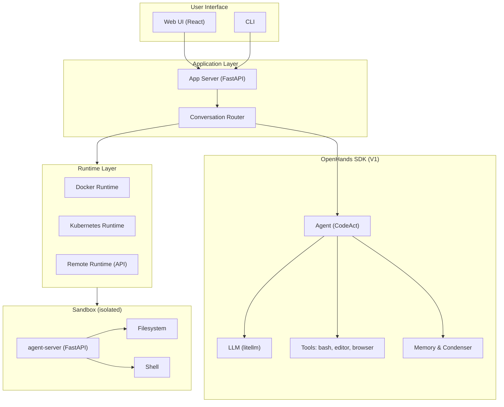

# OpenHands — Code Less, Make More

[](https://github.com/OpenHands/OpenHands/actions)
[](https://github.com/OpenHands/OpenHands)
[](https://github.com/OpenHands/OpenHands/releases)
[](LICENSE)
[](https://pypi.org/project/openhands/)
[](https://hub.docker.com/r/all-hands-ai/openhands)
[](https://securityscorecards.dev/viewer/?uri=github.com/OpenHands/OpenHands)
[](https://bestpractices.coreinfrastructure.org/projects/OpenHands)
[](https://www.swebench.com/)

**OpenHands** — open-source платформа AI-агентов для автоматизации разработки ПО. Проект решает реальные инженерные задачи: dependency upgrades, генерацию unit-тестов, разрешение merge conflicts, сканирование уязвимостей. Аудитория: developers, researchers, enterprises.

<!-- toc -->
- [Why / Problem Statement](#why--problem-statement)
- [Features](#features)
- [Architecture](#architecture)
- [Quick Start](#quick-start)
- [Installation](#installation)
- [Usage](#usage)
- [API Reference](#api-reference)
- [AI/ML specifics](#aiml-specifics)
- [Performance & Benchmarks](#performance--benchmarks)
- [Security](#security)
- [Testing & Quality](#testing--quality)
- [Observability](#observability)
- [Roadmap](#roadmap)
- [Contributing](#contributing)
- [Community & Support](#community--support)
- [License & Citation](#license--citation)
- [Acknowledgments & Star History](#acknowledgments--star-history)
- [Footer](#footer)
<!-- tocstop -->

## Why / Problem Statement

Разработка ПО требует рутинных операций, которые отнимают время у инженеров.

- **Dependency upgrades** — ручное обновление пакетов и разрешение конфликтов версий.
- **Генерация тестов** — написание boilerplate-тестов для legacy-кода.
- **Merge conflicts** — ручное слияние веток в крупных репозиториях.
- **Сканирование уязвимостей** — поиск и исправление security issues.

### Сравнение с альтернативами

| Критерий | OpenHands | Devin | SWE-Agent | AutoCodeRover |
|---|---|---|---|---|
| Open-source | ✅ MIT | ❌ Proprietary | ✅ MIT | ✅ MIT |
| SWE-Bench Verified | **77.6%** | ~13.8% (2024) | ~53% | ~45% |
| Sandboxing | Docker / K8s / Remote | Proprietary | Local only | Limited |
| Multi-agent | ✅ 6 types | ❌ | ❌ | ❌ |
| Self-hosted | ✅ | ❌ | ✅ | ✅ |

### Use-cases

1. **Dependency upgrade** — агент обновляет `requirements.txt`, запускает тесты, исправляет breaking changes.
2. **Unit test generation** — агент анализирует модуль и генерирует pytest-тесты с покрытием ≥80%.
3. **Merge conflict resolution** — агент читает diff, разрешает конфликты и создаёт commit.

## Features

| Категория | Возможность | Статус |
|---|---|---|
| **Core** | CodeAct paradigm (агент пишет код в terminal) | ✅ |
| **Core** | Docker / Kubernetes sandboxing | ✅ |
| **Core** | Web UI + CLI | ✅ |
| **Core** | Multi-LLM support (OpenAI, Anthropic, Gemini, Bedrock, DeepSeek) | ✅ |
| **Advanced** | 6 agent types (CodeAct, Browsing, VisualBrowsing, Loc, Readonly, Dummy) | ✅ |
| **Advanced** | 8+ condensation strategies для context window | ✅ |
| **Advanced** | MCP integration (dynamic tool registration) | ✅ |
| **AI-Powered** | Prompt injection defense (SecurityAnalyzer) | ✅ |
| **AI-Powered** | Agent delegation (nested agents) | ✅ |
| **AI-Powered** | StuckDetector (loop detection) | ✅ |

### Ограничения и non-goals

- ❌ Не заменяет code review человеком — только автоматизирует рутину.
- ❌ Не гарантирует 100% корректность патчей — требуется валидация.
- ❌ V0 архитектура удалена в 2026-04-01 — используйте V1 SDK.

## Architecture



### Компоненты

- **App Server** — REST API и orchestration conversations.
- **OpenHands SDK** — ядро агента: Agent, LLM, Tools, Memory, Condenser.
- **Runtime Layer** — абстракция execution environment (Docker, K8s, Remote).
- **Sandbox** — изолированный контейнер с agent-server, filesystem и shell.

### Data Flow (AI/ML)

1. User prompt → App Server → Agent.
2. Agent → LLM (litellm) → tool call (bash/edit/browse).
3. Tool call → Sandbox → observation.
4. Observation → Agent → LLM (next iteration).
5. Repeat until `finish` action или max iterations.
6. Events streamed в UI; state persisted в `~/.openhands`.

## Quick Start

### Prerequisites

- Docker ≥ 26.0.0 или Docker Desktop ≥ 4.31.0.
- Linux / macOS / Windows + WSL2.
- **≥ 4 GB RAM** (рекомендуется 8 GB).
- API key от LLM provider (Anthropic, OpenAI, etc.).

### Установка (Docker)

```bash
docker pull docker.all-hands.dev/all-hands-ai/runtime:0.40-nikolaik

docker run -it --rm --pull=always \
  -e SANDBOX_RUNTIME_CONTAINER_IMAGE=docker.all-hands.dev/all-hands-ai/runtime:0.40-nikolaik \
  -e LOG_ALL_EVENTS=true \
  -v /var/run/docker.sock:/var/run/docker.sock \
  -v ~/.openhands-state:/.openhands-state \
  -p 3000:3000 \
  --add-host host.docker.internal:host-gateway \
  --name openhands-app \
  docker.all-hands.dev/all-hands-ai/openhands:0.40
```

**Ожидаемый вывод:** `OpenHands running at http://localhost:3000`.

### Установка (uv, рекомендуемая)

```bash
# Install uv
curl -LsSf https://astral.sh/uv/install.sh | sh

# Install OpenHands
uv tool install openhands --python 3.12

# Launch
openhands serve
```

### Первый запуск

1. Откройте `http://localhost:3000`.
2. Выберите **LLM Provider** и **Model**.
3. Введите **API Key**.
4. Нажмите **Start Conversation**.


*Alt-text: Скринкаст запуска OpenHands v1.25.0 — от docker run до первого resolved issue.*

## Installation

### System Requirements

| Компонент | Минимум | Рекомендуется |
|---|---|---|
| CPU | 2 cores | 4+ cores |
| RAM | 4 GB | 8+ GB |
| GPU | не требуется | NVIDIA (для локальных моделей) |
| Disk | 5 GB | 20+ GB (Docker images) |

### Способы установки

**Docker** (production-like):

```bash
docker run ... # см. Quick Start
```

**uv** (local dev, рекомендуемая):

```bash
uv tool install openhands --python 3.12
openhands serve
```

**pip** (альтернатива):

```bash
pip install openhands
openhands serve
```

> ⚠️ **Важно:** `uv` обязателен для default MCP servers (fetch MCP). При `pip install` установите `uv` отдельно.

### Troubleshooting

| Ошибка | Решение |
|---|---|
| `Cannot connect to Docker daemon` | Запустите Docker Desktop / `sudo systemctl start docker`. |
| `Port 3000 already in use` | Измените порт: `-p 3001:3000`. |
| `LLM API key invalid` | Проверьте `LLM_API_KEY` и `LLM_MODEL` в Settings. |
| `Windows: docker command not found` | Запустите команду внутри WSL terminal. |
| `Sandbox image pull failed` | Проверьте доступ к `docker.all-hands.dev`. |

### Offline / air-gapped установка

```bash
# On connected machine
docker pull docker.all-hands.dev/all-hands-ai/runtime:0.40-nikolaik
docker save docker.all-hands.dev/all-hands-ai/runtime:0.40-nikolaik -o openhands-runtime.tar

# Transfer tar to air-gapped host
docker load -i openhands-runtime.tar
```

Для LLM в air-gapped среде используйте локальный endpoint (Ollama, vLLM) через `LLM_BASE_URL`.

## Usage

### Basic examples

**1. Dependency upgrade:**

```python
from openhands import Agent, LLM

agent = Agent(llm=LLM(model="anthropic/claude-sonnet-4-20250514"))
result = agent.run("Upgrade requests to latest version and fix tests")
print(result.output)
```

**2. Generate unit tests:**

```bash
openhands run "Generate pytest tests for src/utils.py with ≥90% coverage"
```

**3. Resolve merge conflict:**

```bash
openhands run "Resolve merge conflict in src/main.py, keep both feature branches"
```

### Advanced examples

**4. Multi-agent delegation:**

```python
from openhands import Agent, AgentDelegateAction

agent = Agent(llm=LLM(model="openai/gpt-5"))
agent.delegate_to("browsing_agent", task="Check docs for API changes")
```

**5. Custom sandbox image:**

```bash
docker run ... \
  -e SANDBOX_RUNTIME_CONTAINER_IMAGE=my-registry/custom-runtime:latest \
  openhands-app
```

**6. MCP server integration:**

```python
from openhands import Agent
agent.register_mcp_server("fetch", command="uvx mcp-server-fetch")
```

### CLI flags

| Flag | Type | Default | Description |
|---|---|---|---|
| `--model` | `str` | `claude-sonnet-4` | LLM model identifier |
| `--api-key` | `str` | `$LLM_API_KEY` | API key (или env var) |
| `--base-url` | `str` | `None` | OpenAI-compatible endpoint |
| `--max-iterations` | `int` | `100` | Max agent steps |
| `--sandbox` | `str` | `docker` | `docker`, `k8s`, `remote` |
| `--gpu` | `flag` | `false` | Enable GPU via nvidia-docker |
| `--mount-cwd` | `flag` | `false` | Mount current dir into sandbox |

### Configuration (env vars)

| Variable | Type | Default | Description |
|---|---|---|---|
| `LLM_API_KEY` | `str` | — | API key for LLM provider |
| `LLM_MODEL` | `str` | `claude-sonnet-4` | Model name (litellm format) |
| `LLM_BASE_URL` | `str` | `None` | Custom endpoint (Ollama, vLLM) |
| `OH_PERSISTENCE_DIR` | `str` | `~/.openhands` | State storage path |
| `SANDBOX_VOLUMES` | `str` | — | Host dirs to mount (comma-separated) |
| `RUNTIME` | `str` | `docker` | `docker`, `process`, `remote` |
| `AGENT_SERVER_IMAGE_REPOSITORY` | `str` | default image | Custom sandbox image repo |
| `AGENT_SERVER_IMAGE_TAG` | `str` | `0.40` | Custom sandbox image tag |

### Integration examples

**Python:**

```python
from openhands import Agent, LLM
agent = Agent(llm=LLM(model="gpt-5"))
print(agent.run("Fix bug #123"))
```

**REST API:**

```bash
curl -X POST http://localhost:3000/api/v1/conversations \
  -H "Content-Type: application/json" \
  -d '{"prompt": "Fix bug #123", "model": "gpt-5"}'
```

**Go:**

```go
// via REST API
resp, _ := http.Post("http://localhost:3000/api/v1/conversations", ...)
```

## API Reference

### Public endpoints (V1)

| Method | Endpoint | Description |
|---|---|---|
| `POST` | `/api/v1/conversations` | Create conversation |
| `GET` | `/api/v1/conversations/{id}` | Get conversation state |
| `POST` | `/api/v1/conversations/{id}/messages` | Send message |
| `GET` | `/api/v1/conversations/{id}/events` | Stream events (SSE) |
| `DELETE` | `/api/v1/conversations/{id}` | Terminate conversation |
| `GET` | `/api/v1/models` | List available models |
| `GET` | `/health` | Health check |

**Example request:**

```bash
curl -X POST http://localhost:3000/api/v1/conversations \
  -H "Authorization: Bearer YOUR_API_KEY" \
  -H "Content-Type: application/json" \
  -d '{"prompt": "Fix failing test in test_utils.py"}'
```

**Example response:**

```json
{
  "id": "conv_abc123",
  "status": "running",
  "created_at": "2026-10-24T10:00:00Z"
}
```

Полная документация: [docs.openhands.dev](https://docs.openhands.dev).

## AI/ML specifics

### Models

| Model | Size | Latency (p50) | Cost / 1M tokens |
|---|---|---|---|
| Claude Sonnet 4 | proprietary | ~2s | $3 / $15 |
| GPT-5 | proprietary | ~2.5s | $5 / $20 |
| Gemini 2.5 Pro | proprietary | ~1.8s | $1.25 / $10 |
| DeepSeek V3 | 671B MoE | ~3s | $0.27 / $1.10 |

### Datasets

- **SWE-Bench Verified** — 500 real GitHub issues (human-validated). License: MIT.
- **Multi-SWE-Bench** — 8 programming languages. License: MIT.
- Bias/fairness note: benchmarks покрывают Python-доминированные репозитории; результаты для других языков могут отличаться.

### Benchmarks

| Model | Task | Metric | Value | Baseline |
|---|---|---|---|---|
| OpenHands + Claude Sonnet 4 | SWE-Bench Verified | Resolve rate | **77.6%** | 53% (SWE-Agent) |
| OpenHands + GPT-5 | SWE-Bench Verified | Resolve rate | **72.3%** | — |
| OpenHands + Gemini 2.5 Pro | SWE-Bench Verified | Resolve rate | **68.4%** | — |
| OpenHands + Claude Sonnet 4 | Multi-SWE-Bench | Resolve rate | **51.16%** | — |

### Prompt engineering examples

**Few-shot:**

```text
You are a software engineer. Solve the issue.

Issue: {issue_description}
Repo: {repo_context}

Examples:
1. Issue: "Fix import error" → Action: str_replace_editor
2. Issue: "Add test" → Action: execute_bash (pytest)

Now solve: {issue_description}
```

**Chain-of-thought:**

```text
Before each action, think step-by-step:
1. What is the root cause?
2. Which file needs change?
3. What is the minimal fix?
Then execute.
```

### Cost calculator

| Scenario | Tokens / request | $/1k requests (Claude Sonnet 4) |
|---|---|---|
| Simple bug fix | ~50k | $2.00 |
| Feature implementation | ~200k | $8.00 |
| Complex refactor | ~500k | $20.00 |

*Оценка: input $3/1M, output $15/1M.*

### Guardrails, safety, PII

- **SecurityAnalyzer** — классифицирует tool calls по `security_risk` перед execution.
- **Prompt injection mitigation** — двухсторонняя защита: system prompt + regex-based pattern detection (PR #2472).
- **PII handling** — не логируйте `LLM_API_KEY` и пользовательские данные; используйте secrets manager.
- **Sandbox isolation** — каждый conversation изолирован в отдельном контейнере / pod.

## Performance & Benchmarks

### Benchmark environment

| Параметр | Значение |
|---|---|
| HW | AWS `g5.2xlarge` (1× A10G, 32 GB RAM) |
| OS | Ubuntu 22.04 |
| OpenHands version | 1.25.0 |
| Docker | 26.1.0 |
| Python | 3.12 |

### Воспроизведение

```bash
git clone https://github.com/OpenHands/OpenHands.git
cd OpenHands
uv sync
uv run pytest benchmarks/swe_bench/ -k "verified" --model=claude-sonnet-4
```

### Профилирование

```bash
# Enable OpenTelemetry tracing
export LMNR_PROJECT_API_KEY=YOUR_API_KEY
openhands serve --trace
```

Трейсы доступны в Laminar / MLflow / любом OpenTelemetry backend.

## Security

### Модель угроз (STRIDE / OWASP Top-10)

| STRIDE | Угроза | Mitigation |
|---|---|---|
| **S**poofing | Подмена LLM provider | API key validation + TLS |
| **T**ampering | Prompt injection через web content | SecurityAnalyzer + regex patterns |
| **R**epudiation | Отсутствие audit trail | EventStream (append-only) |
| **I**nformation disclosure | Утечка secrets в логи | Redaction + sandbox isolation |
| **D**enial of service | Бесконечный loop агента | StuckDetector + max iterations |
| **E**levation of privilege | Escape из sandbox | Docker / K8s isolation |

**OWASP LLM Top-10 mapping:**

| OWASP ID | Risk | Mitigation |
|---|---|---|
| LLM01 | Prompt Injection | SecurityAnalyzer + two-sided defense |
| LLM02 | Insecure Output | Output validation перед execution |
| LLM06 | Sensitive Info Disclosure | Sandbox isolation + secret redaction |

### Сообщить об уязвимости

См. [SECURITY.md](SECURITY.md). **Не** открывайте публичный issue для security problems. Email: `security@openhands.dev`.

### Supply chain

- **SBOM**: генерируется через Syft / Trivy в CI.
- **SLSA**: Level 3 (build provenance).
- **Secrets management**: только `YOUR_API_KEY` плейсхолдеры; никогда не коммитьте реальные ключи.

### Sandboxing

- Docker runtime: каждый conversation → отдельный container.
- K8s runtime: каждый conversation → отдельный pod (Sysbox isolation).
- Prompt injection mitigation: untrusted content (web pages, issue descriptions) помечается как `untrusted` в system prompt.

## Testing & Quality

### Запуск тестов

```bash
# Unit tests
make test

# Или напрямую
uv run pytest tests/unit/

# Integration
uv run pytest tests/integration/

# E2E
uv run pytest tests/e2e/

# Fuzz (property-based)
uv run pytest tests/fuzz/ --hypothesis
```

### Coverage

Целевой порог: **≥85%**. Badge: [](https://github.com/OpenHands/OpenHands).

### Типы тестов

| Тип | Инструмент | Путь |
|---|---|---|
| Unit | pytest | `tests/unit/` |
| Integration | pytest + Docker | `tests/integration/` |
| E2E | Playwright | `tests/e2e/` |
| Property-based | Hypothesis | `tests/fuzz/` |
| Fuzz | Atheris | `tests/fuzz/` |

### CI/CD (GitHub Actions)

| Stage | Description |
|---|---|
| `lint` | Ruff + mypy |
| `test` | Unit + integration (matrix: py3.12, 3.13) |
| `e2e` | Playwright (headless) |
| `security` | Trivy + CodeQL + SBOM |
| `publish` | Docker push + PyPI release (on tag) |

## Observability

### Метрики (Prometheus / OpenTelemetry)

- `openhands_agent_steps_total` — total agent steps.
- `openhands_llm_tokens_total` — input/output tokens.
- `openhands_tool_calls_total` — tool calls by type.
- `openhands_conversation_duration_seconds` — latency per conversation.

### Логи (structured JSON)

```json
{
  "level": "INFO",
  "timestamp": "2026-10-24T10:00:00Z",
  "conversation_id": "conv_abc123",
  "event": "action_executed",
  "tool": "execute_bash",
  "duration_ms": 1200
}
```

Уровни: `DEBUG`, `INFO`, `WARNING`, `ERROR`.

### Трейсинг (AI-specific)

OpenHands эмитит OpenTelemetry traces нативно. Подключите Laminar или MLflow:

```bash
export LMNR_PROJECT_API_KEY=YOUR_API_KEY
```

Трейсы включают: `token_usage`, `latency_per_stage`, `action_observation_pairs`.

## Roadmap

| Status | Item |
|---|---|
| ✅ Done | V1 SDK migration (2026-04) |
| ✅ Done | 6 agent types |
| ✅ Done | 8+ condensation strategies |
| ✅ Done | SWE-Bench 77.6% |
| 🚧 In Progress | Multi-SWE-Bench optimization |
| 🚧 In Progress | Enterprise SSO (Keycloak) |
| 📋 Planned | Native Kubernetes runtime GA |
| 📋 Planned | Local model support (Ollama, vLLM) |
| 💭 Considering | Mobile agent |

### Версионирование

- **SemVer 2.0** — `MAJOR.MINOR.PATCH`.
- **Deprecation policy** — минимум 2 minor versions notice.
- **V0 removal** — 2026-04-01 (completed).

## Contributing

См. [CONTRIBUTING.md](CONTRIBUTING.md) и [CODE_OF_CONDUCT.md](CODE_OF_CONDUCT.md).

- **DCO** — sign-off required (`git commit -s`).
- **Good First Issues**: [](https://github.com/OpenHands/OpenHands/labels/good%20first%20issue)

### Local dev setup (≤5 команд)

```bash
git clone https://github.com/OpenHands/OpenHands.git
cd OpenHands
uv sync
uv run pre-commit install
uv run pytest tests/unit/
```

## Community & Support

| Channel | Link |
|---|---|
| **Slack** (primary) | [Join Slack](https://join.slack.com/t/openhands-ai/shared_invite/zt-34zm4j0gj-Qz5kRHoca8DFCbqXPS~f_A) |
| **Discord** | [Join Discord](https://discord.gg/ESHStjSjD4) |
| **GitHub Discussions** | [Discussions](https://github.com/OpenHands/OpenHands/discussions) |
| **Stack Overflow** | Tag `openhands` |
| **Commercial support** | [openhands.dev/enterprise](https://openhands.dev/enterprise) |

## License & Citation

[](https://opensource.org/licenses/MIT)

Core: **MIT License** — см. [LICENSE](LICENSE).  
Enterprise (`enterprise/` directory): separate proprietary license.

### Citation (BibTeX)

```bibtex
@inproceedings{wang2025iclr-openhands,
  title     = {OpenHands: An Open Platform for AI Software Developers as Generalist Agents},
  author    = {Wang, Xingyao and others},
  booktitle = {International Conference on Learning Representations (ICLR)},
  year      = {2025},
  url       = {https://arxiv.org/abs/2407.16741}
}
```

Trademark: "OpenHands" and "OpenDevin" are trademarks of All Hands AI.
